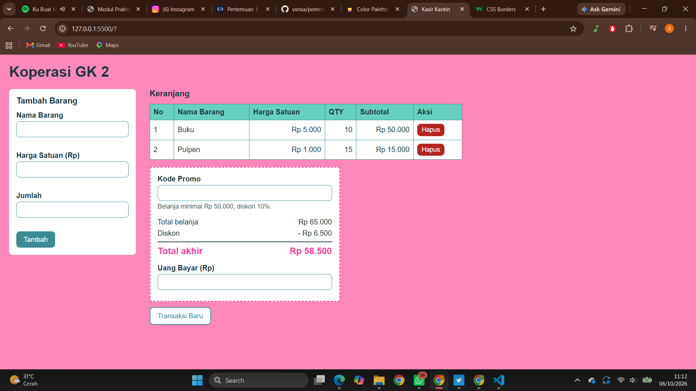

# Mini POS – Kasir & Keranjang Belanja Sederhana

## Identitas
- Nama Lengkap: Sheiryzka Revania Maharani
- NIM: 124140013
- Kelas Praktikum: Pengembangan Aplikasi Website RA

## Deskripsi Aplikasi
Aplikasi web kasir untuk Koperasi Kampus. Kasir memasukkan barang, lalu aplikasi menghitung subtotal, total, diskon, dan kembalian secara otomatis. Keranjang disimpan di localStorage sehingga tidak hilang saat di-refresh.

## Panduan Menjalankan
1. Clone repository ini.
2. Buka folder proyek di VS Code.
3. Klik kanan `index.html` → Open with Live Server.

## Daftar Fitur
- [V] Validasi nama (min. 3 karakter), harga (min. Rp 500), qty (bilangan bulat min. 1)
- [V] Pesan error di bawah input, form di-reset jika berhasil
- [V] Subtotal per barang dan total belanja otomatis
- [V] Diskon 10% (belanja ≥ Rp 50.000 atau kode HEMAT10)
- [V] Uang bayar dan kembalian otomatis
- [V] Tabel keranjang dengan tombol Hapus
- [V] Penyimpanan localStorage (JSON.stringify / JSON.parse)
- [V] Tombol Transaksi Baru

## Tangkapan Layar
1. Form input utama
.png>)
2. Validasi error
.png>)
.png>)
.png>)
3. Hasil perhitungan dan tabel

## Penjelasan Teknis Singkat
- Validasi: `validasiForm()` memeriksa tiga input saat submit dan menampilkan pesan lewat `tampilkanError()`. Jika ada yang salah, fungsi mengembalikan `null` sehingga barang tidak masuk keranjang.
- Kalkulator: `hitungSubtotal()` (harga × qty), `hitungTotal()` (reduce semua subtotal), `hitungDiskon()` (10% jika total ≥ 50.000 atau kode HEMAT10), total akhir = total − diskon, kembalian = uang bayar − total akhir.
- localStorage: `simpanKeranjang()` memakai `JSON.stringify()` setiap ada perubahan, `muatKeranjang()` memakai `JSON.parse()` saat halaman dibuka.