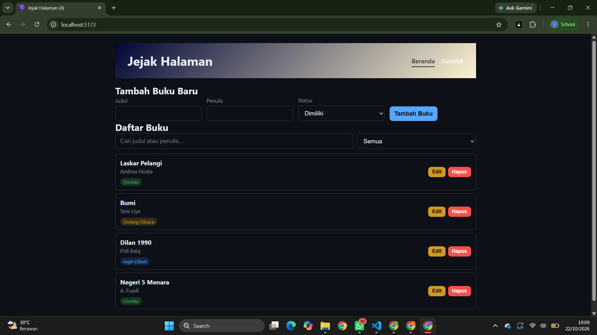
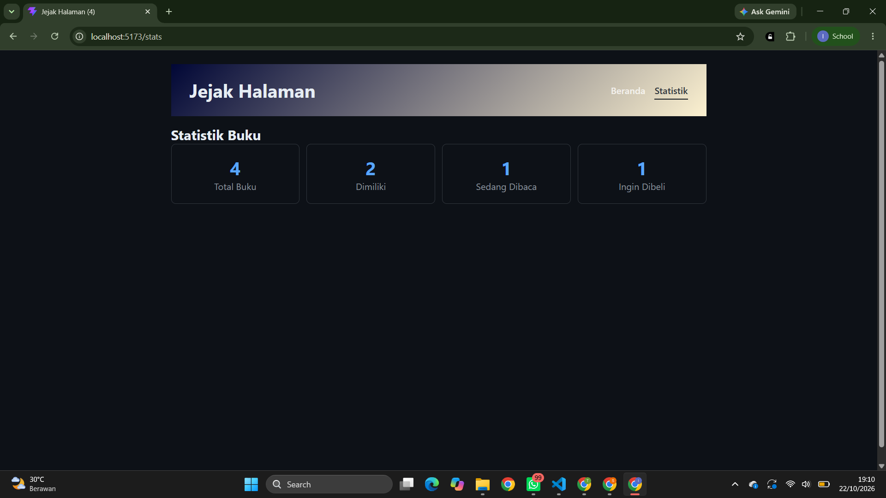
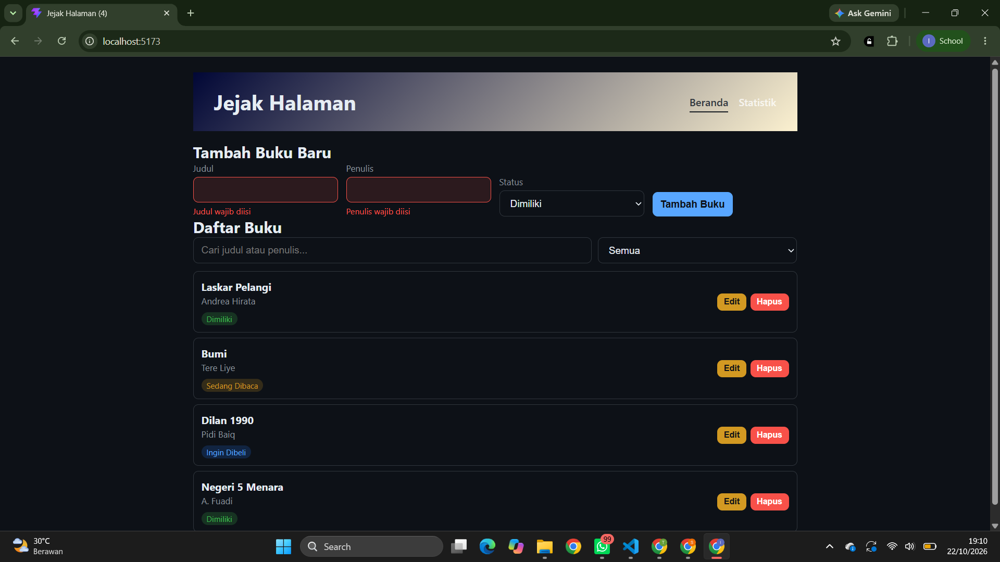
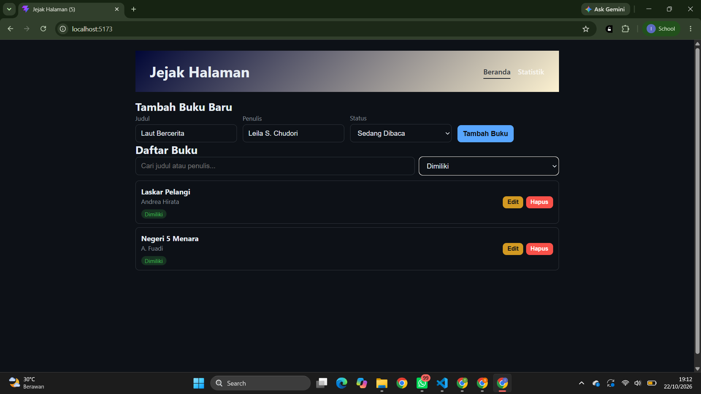
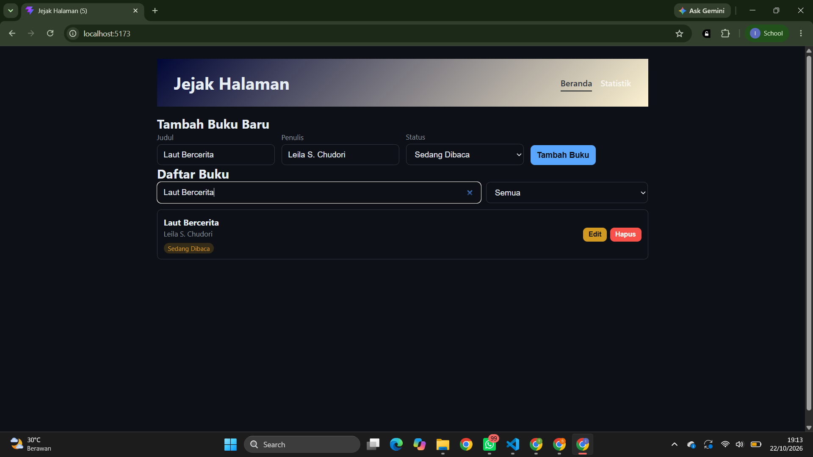
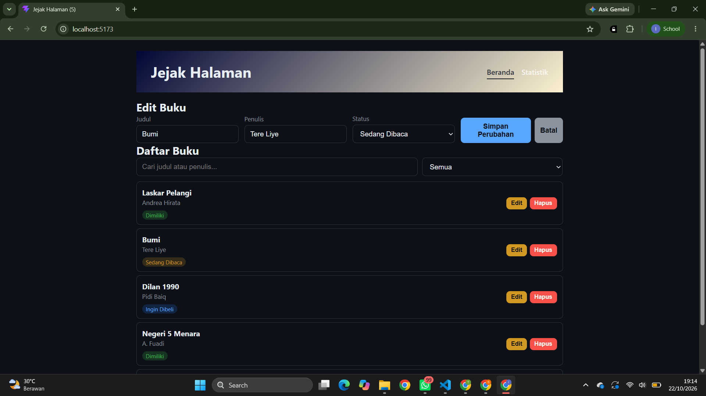
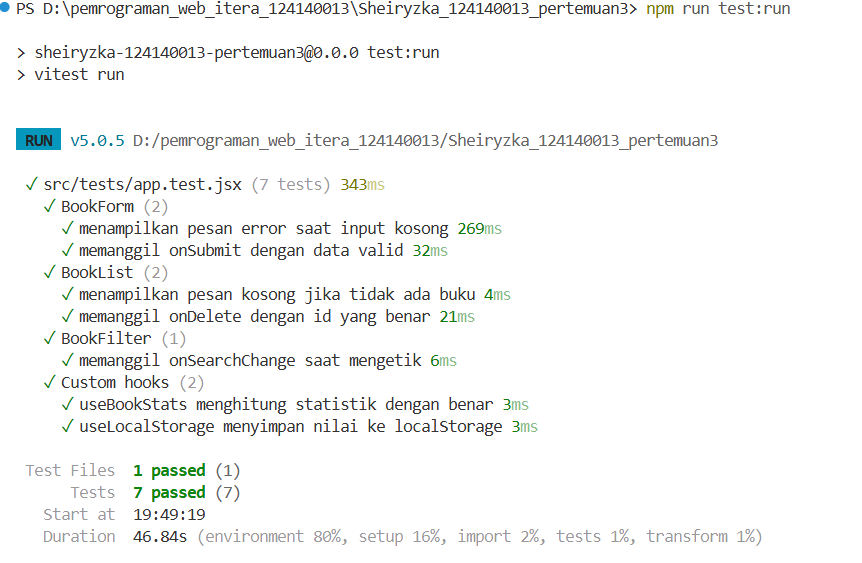

# jejak Halaman

## Data Diri
- Nama: Sheiryzka revania Maharani
- NIM: 124140013
- Kelas Praktikum : Pengembangan Aplikasi Website RA

## Deskripsi
Aplikasi web untuk mencatat buku yang dimiliki, sedang dibaca, atau ingin dibeli.
Fitur: tambah, edit, hapus buku, filter berdasarkan status, pencarian judul/penulis,
halaman statistik, dan data tersimpan di localStorage.

## Instalasi & Menjalankan
```bash
npm install
npm run dev
```
Buka http://localhost:5173. Untuk testing: `npm run test:run`.

## Screenshot







## Laporan Testing


## Fitur React yang Digunakan
- **useState & useEffect**: state form, filter, dan sinkronisasi judul dokumen / localStorage
- **Context API** (`BookContext`): state management global untuk data buku, filter, dan aksi CRUD
- **React Router**: navigasi multi-halaman (`/` dan `/stats`)
- **Custom Hooks**: `useLocalStorage` dan `useBookStats`
- **Reusable Components**: `BookForm`, `BookList`, `BookFilter`
- **PropTypes**: type checking di semua komponen
- **Error Handling**: validasi form dengan feedback visual
- **Testing**: 7 unit test dengan Vitest + React Testing Library