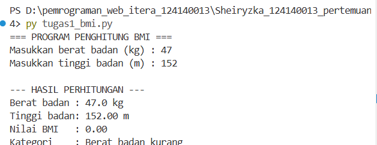
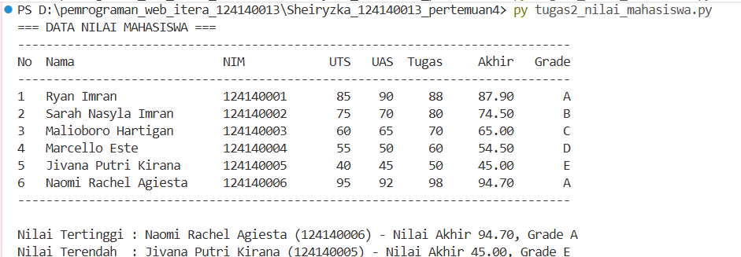
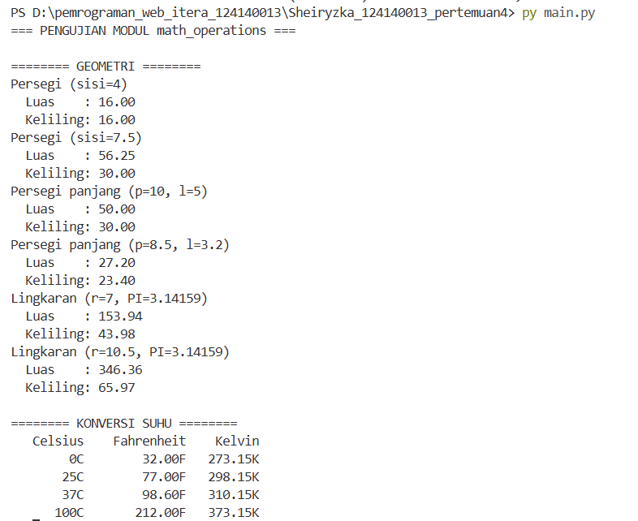

# Tugas Praktikum Pertemuan 4: Python Dasar

## Identitas
- Nama: Sheiryzka Revania Maharani
- NIM : 124140013
- Kelas: RA

## Deskripsi Program

### Soal 1: Penghitung BMI (`tugas1_bmi.py`)
Meminta input berat badan (kg) dan tinggi badan (m), menghitung BMI dengan
rumus `berat / (tinggi * tinggi)`, lalu menentukan kategori memakai
`if-elif-else` (kurang, normal, berlebih, obesitas). Input divalidasi agar
harus berupa angka positif. Hasil ditampilkan dengan 2 angka desimal.

### Soal 2: Data Nilai Mahasiswa (`tugas2_nilai_mahasiswa.py`)
Menyimpan 6 data mahasiswa dalam list of dictionary, menghitung nilai akhir
(30% UTS + 40% UAS + 30% Tugas), menentukan grade A-E, menampilkan tabel
rapi di terminal, lalu menampilkan mahasiswa dengan nilai akhir tertinggi
dan terendah.

### Soal 3: Modul Matematika (`math_operations.py` dan `main.py`)
`math_operations.py` berisi konstanta `PI`, fungsi luas dan keliling
(persegi, persegi panjang, lingkaran), serta konversi suhu (Celsius ke
Fahrenheit dan Kelvin). `main.py` mengimpor modul tersebut dengan 3 cara
berbeda (`import`, `from ... import`, dan `import ... as`) dan memanggil
seluruh fungsinya.

## Cara Menjalankan
Pastikan Python 3.8+ terpasang, lalu buka terminal di folder ini:

```bash
python tugas1_bmi.py
python tugas2_nilai_mahasiswa.py
python main.py
```

(Gunakan `python3` jika `python` tidak dikenali.)

## Screenshot Hasil Eksekusi

### Soal 1


### Soal 2


### Soal 3
