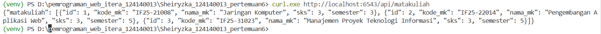
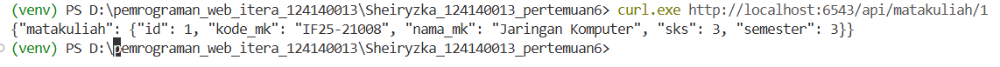
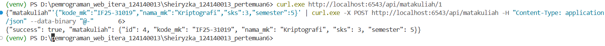
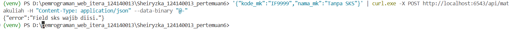
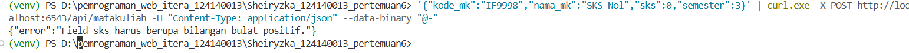
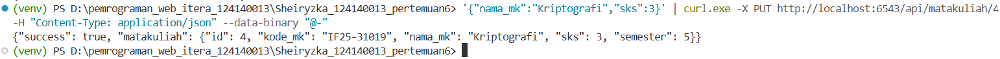
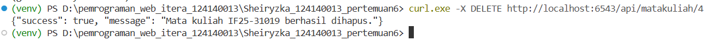
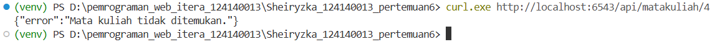
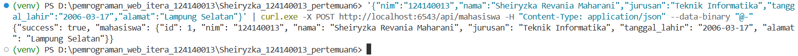
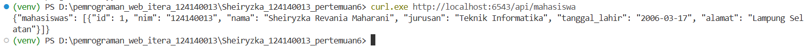

# Praktikum Pengembangan Aplikasi Web — Pertemuan 6

## Identitas
- Nama: Sheiryzka Revania Maharani
- NIM: 124140013
- Kelas praktikum: RA

## Deskripsi
RESTful API berbasis Pyramid untuk pengelolaan data mahasiswa dan mata kuliah. Aplikasi menggunakan PostgreSQL, SQLAlchemy ORM, dan Alembic. API Matakuliah mendukung operasi daftar, detail, tambah, ubah, dan hapus; nilai SKS dan semester divalidasi sebagai bilangan bulat positif.

## Persiapan
Persyaratan: Python 3.10+ dan PostgreSQL. Perintah berikut dijalankan dari direktori `Sheiryzka_124140013_pertemuan6`.

### 1. Buat dan aktifkan virtual environment

```bash
# Windows PowerShell (gunakan launcher Python):
py -m venv venv
venv\Scripts\Activate.ps1
# macOS/Linux:
python3 -m venv venv
source venv/bin/activate
```

### 2. Siapkan PostgreSQL

Masuk ke `psql` sebagai administrator, lalu jalankan:

```sql
CREATE DATABASE pyramid_mahasiswa;
CREATE USER pyramid_user WITH ENCRYPTED PASSWORD 'pyramid_pass';
GRANT ALL PRIVILEGES ON DATABASE pyramid_mahasiswa TO pyramid_user;
\connect pyramid_mahasiswa
GRANT ALL ON SCHEMA public TO pyramid_user;
```

Connection string lokal ada di `development.ini`. Sesuaikan jika username, password, host, port, atau nama database berbeda. Jangan gunakan kredensial contoh untuk deployment.

### 3. Instal aplikasi dan migrasikan database

```bash
python -m pip install --upgrade pip
python -m pip install -e .
alembic -c development.ini upgrade head
python -m pyramid_mahasiswa.scripts.initialize_db development.ini
```

Migrasi membuat tabel `mahasiswa` dan `matakuliah`. Skrip seed menambahkan tiga mata kuliah contoh dan aman dijalankan berulang kali.

### 4. Jalankan API

```bash
pserve development.ini --reload
```

Server lokal berjalan di `http://localhost:6543`.

## Endpoint API

### Mahasiswa

| Method | Endpoint | Keterangan |
| --- | --- | --- |
| GET | `/api/mahasiswa` | Daftar seluruh mahasiswa |
| GET | `/api/mahasiswa/{id}` | Detail mahasiswa |
| POST | `/api/mahasiswa` | Tambah mahasiswa |
| PUT | `/api/mahasiswa/{id}` | Perbarui data mahasiswa |
| DELETE | `/api/mahasiswa/{id}` | Hapus mahasiswa |

### Matakuliah

| Method | Endpoint | Keterangan |
| --- | --- | --- |
| GET | `/api/matakuliah` | Daftar seluruh mata kuliah |
| GET | `/api/matakuliah/{id}` | Detail mata kuliah |
| POST | `/api/matakuliah` | Tambah mata kuliah |
| PUT | `/api/matakuliah/{id}` | Perbarui sebagian field mata kuliah |
| DELETE | `/api/matakuliah/{id}` | Hapus mata kuliah |

Contoh body POST:

```json
{
  "kode_mk": "IF25-21008",
  "nama_mk": "Pengembangan Aplikasi Web",
  "sks": 3,
  "semester": 5
}
```

Contoh pengujian dengan cURL (jalankan di terminal kedua):

```bash
# Mahasiswa
curl -i http://localhost:6543/api/mahasiswa
curl -i http://localhost:6543/api/mahasiswa/1
curl -i -X POST http://localhost:6543/api/mahasiswa -H "Content-Type: application/json" -d '{"nim":"124140099","nama":"Contoh Mahasiswa","jurusan":"Teknik Informatika","tanggal_lahir":"2003-02-12","alamat":"Bandar Lampung"}'
curl -i -X PUT http://localhost:6543/api/mahasiswa/1 -H "Content-Type: application/json" -d '{"jurusan":"Informatika"}'
curl -i -X DELETE http://localhost:6543/api/mahasiswa/1

# Matakuliah
curl -i http://localhost:6543/api/matakuliah
curl -i http://localhost:6543/api/matakuliah/1
curl -i -X POST http://localhost:6543/api/matakuliah -H "Content-Type: application/json" -d '{"kode_mk":"IF3999","nama_mk":"Praktikum API","sks":2,"semester":6}'
curl -i -X PUT http://localhost:6543/api/matakuliah/1 -H "Content-Type: application/json" -d '{"nama_mk":"Pemrograman Web Lanjut","sks":4}'
curl -i -X DELETE http://localhost:6543/api/matakuliah/1
```

Request tidak lengkap, kode mata kuliah duplikat, atau nilai SKS/semester yang bukan integer positif menghasilkan `400 Bad Request`. ID yang tidak ditemukan menghasilkan `404 Not Found`.

## Struktur utama

- `pyramid_mahasiswa/models/`: model SQLAlchemy dan konfigurasi session
- `pyramid_mahasiswa/views/mahasiswa.py` dan `pyramid_mahasiswa/views/matakuliah.py`: controller API CRUD
- `pyramid_mahasiswa/routes.py`: route dengan predicate HTTP method
- `pyramid_mahasiswa/alembic/versions/`: migrasi skema database
- `pyramid_mahasiswa/scripts/initialize_db.py`: data awal idempoten

## Bukti pengujian









